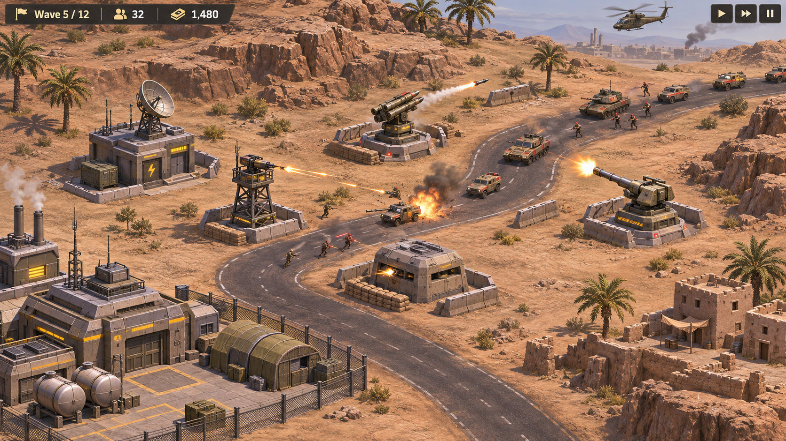

# 012 — Единый стек графики, эффектов и моделей

Дата: 2026-11-13. Статус: S0–S5 проверены; следующий срез S6.

## Решения пользователя

- Миграция по сквозным срезам, не переписывание всей игры с нуля.
- Сохраняем Vite, TypeScript strict, Vue 3, Pinia, hash-router, FSD, Tiled, кампанию, сохранения и детерминированную симуляцию 30 Гц.
- Rapier отвечает только за визуальные обломки и падения. Попадания, урон, движение врагов, руины и занятость клеток определяет прежняя симуляция. Физика не пишет обратно в неё и не входит в реплей.
- Сначала этот пакет, затем оставшиеся задачи 007–011. Выполненные задачи не отменяем; новую механику M14, мобильный UI и service worker не добавляем попутно.
- Реализация разрешена пользователем после составления плана. Работа идёт по срезам; независимые read-only проверки выполняются субагентами параллельно, изменения общих файлов и e2e — последовательно.

## 1. Анализ текущего проекта

Основание: `package.json`, текущие исходники и инструменты на HEAD `ed62f4f`, `PROGRESS.md`, SPEC. Обзор графа зависимостей устарел относительно HEAD, поэтому выводы ниже опираются также на чтение текущих файлов. Тесты и FPS в рамках составления плана не запускались; старые результаты из PROGRESS не считаются новой проверкой.

| Область | Сейчас | Что меняем |
|---|---|---|
| Рендер | `three@0.186.1`, `@types/three@0.186.0`; `widgets/battlefield/lib/three3d.ts` создаёт сцену, ресурсы, подписки, интерполяцию, RAF и прямой `renderer.render` | Сохраняем Three.js, ввод, камеру и инстансинг. Добавляем один контролируемый путь кадра через postprocessing для high; прямой рендер для low |
| Эффекты | `three/effects.ts`: пул сфер InstancedMesh, ручное изменение шейдера прозрачности; дым ракет создаётся из `three3d.ts` | Заменяем реализацию частиц на three.quarks, не оставляем два движка эффектов |
| Освещение | Ambient + DirectionalLight, blob-тени врагов, без AO | N8AO для контактов и углов; это не замена направленным теням. Blob-тени сохраняем для читаемости, включая дронов |
| Качество | `shared/lib/three/quality.ts` уже содержит high/low, DPR 2/1.5 и лимиты 128/48. В просмотренном конструкторе сцены ещё жёстко заданы MSAA и DPR 2 | Подключаем существующий профиль ко всем новым подсистемам, не вводим второй конфиг качества |
| UI | Vue-компоненты и CSS; GSAP отсутствует в зависимостях | GSAP для согласованных переходов панелей/окон, без замены Vue и без анимации боевого состояния |
| Физика | Траектории и момент урона считает чистая TS-симуляция; разрушение рисует вспышку и статические руины | Отдельный визуальный мир Rapier для ограниченного числа обломков поверх неизменных руин |
| Модели | `tools/models/*.py`, `pehota/*.py`, экспорт GLB через bpy; Kenney CC0 и оригинальная геометрия; установлен каталог Blender 5.2 | Это уже нужный подход. Унифицируем запуск, версию, контракт и проверку, не пересоздаём все модели без причины |
| Загрузка GLB | `shared/lib/three/loadModels.ts`: ошибки отдельного файла скрываются с fallback на примитивы; сцена грузит GLB асинхронно | Явное владение геометриями, материалами и текстурами, обработка завершения загрузки после dispose. Обязательные ассеты — ошибка с повтором, не тихий fallback |
| Проверка ассетов | `tools/models/verify.mjs` и отдельные Blender-проверки; список моделей и проверки разрознены | Полное покрытие используемых GLB; bbox с учётом иерархии и трансформаций, узлы, pivots, бюджеты и материалы |
| Регрессии | Vitest, golden-реплеи, балансные тесты, e2e камеры/ввода/ремонта/context loss/perf | Используем существующие проверки; добавляем только недостающие для нового жизненного цикла и эффектов |

### Расхождения документации с реализацией

- SPEC местами всё ещё описывает примитивы как основной контент, хотя GLB и Blender-пайплайн уже есть.
- WebGL 1 fallback в SPEC не соответствует выбранному современному Three.js/N8AO: целевая платформа — WebGL 2, без параллельного старого рендера.
- Старый критерий «JS не больше, чем до перехода на 3D» не учитывает новый стек и WASM. Нужны измеренный baseline и отдельные бюджеты загрузки.
- `PROGRESS.md` содержит исторические проверки и незавершённые приёмки: их нельзя автоматически закрывать миграцией.

## 2. Целевые зависимости и совместимость

Проверено непосредственно по npm registry 2026-11-12. Ниже точные кандидаты; S1 обязан подтвердить их совместную работу в браузере и зафиксировать lockfile.

| Задача | Пакет / инструмент | Решение |
|---|---|---|
| 3D | `three@0.186.1`, `@types/three@0.186.0` | Оставить текущие версии: обновление до доступной 0.187.0 само по себе не нужно |
| Постобработка | `postprocessing@6.39.6` | Peer Three.js `>=0.168.0 <0.188.0`, текущая версия подходит |
| Контактное затенение | `n8ao@2.0.1` | Ветка 2.0; peers `postprocessing >=6.30.0`, `three >=0.137`. Используем `N8AOPostPass` с composer из postprocessing |
| Частицы | `three.quarks@0.17.1` | Ветка 0.17; peer `three >=0.182.0`, текущая версия подходит. Зависимость `quarks.core: *` требует проверки фактически разрешённой версии в lockfile |
| UI-анимация | `gsap@3.15.1` | Ветка 3.15, только нужные core API, без платных/внешних плагинов и CDN |
| Визуальная физика | `@dimforge/rapier3d-compat@0.21.0` | Ветка 0.21; async init, WASM встроен в JS. Проще для Vite/Pages, без отдельного WASM-плагина. Загружать лениво для боя и не загружать в low |
| Генерация GLB | Blender 5.2.x + Python bpy | Зафиксировать фактически проверенный patch; CLI через `BLENDER`, без абсолютного пути разработчика в скриптах |

Rapier оставляем: он закрывает запрошенную визуальную физику, оснований менять движок пока нет. Если S1 выявит блокирующую проблему WASM/браузеров, отдельно согласовать замену; не поддерживать два движка.

Лицензии библиотек проверить по установленным пакетам, в особенности GSAP (собственная Standard License, не MIT). `public/assets/LICENSES.md` остаётся реестром ассетов, а не заменой лицензий npm-пакетов.

## 3. Границы реализации

### Кадр и ресурсы

- Один владелец RAF и один advance симуляции на кадр. Composer, частицы и физика не запускают собственные игровые циклы.
- High: `RenderPass → N8AOPostPass → SMAA`, с единственной корректной цепочкой tone mapping / преобразования цвета. Порядок и необходимость отдельного color-pass подтвердить S1; двойная gamma correction запрещена.
- Low: прямой рендер без AO и физики обломков, сокращённые частицы, DPR ≤ 1.5, без MSAA. High: DPR ≤ 2; AA настраивается в composer, а не одновременно несколькими дорогими способами.
- N8AO начинает с обычного пресета без neural denoise. Радиус в мировых единицах под масштаб «клетка = 1». Не добавляем bloom, DOF, motion blur, SSAO вторым проходом.
- HUD-билборды, кольца и прозрачные частицы не должны давать грязные AO-ореолы или терять читаемость; порядок/слои определить по проверке в S2, без обязательного нового полного прохода сцены.
- Размеры renderer/composer/AO синхронизированы при resize и смене DPR. Статистика draw calls учитывает весь кадр composer, а не только последний проход.
- На pause/blur/hidden/outcome визуальное время боя останавливается; после возврата нет скачка времени. Для неподвижной сцены не нужен постоянный RAF; ввод и resize могут запросить кадр.
- Все targets, passes, particle systems, Rapier world, подписки, геометрии и материалы освобождаются при выходе. Поздний async init не монтирует ресурсы в уничтоженную сцену.
- Потеря WebGL-контекста ставит бой на паузу; восстановление пересоздаёт нужные графические ресурсы без потери симуляции и без дублирования подписок.

### Частицы и визуальная физика

- События выстрела, попадания, завершения стройки и разрушения остаются источниками эффектов. Тела снарядов и их математические траектории не переносим в Quarks или Rapier.
- Quarks заменяет вспышки, искры, дым, взрывы и эффект завершения. Батчинг, переиспользование эмиттеров, общий материал где возможно; число частиц ограничено профилем. Не требуется покупать редактор эффектов.
- Пламя поддержать в системе пресетов, но подключение огнемёта и его механики остаётся пакету 010.
- Rapier: простая плоскость земли, примитивные коллайдеры и маленькие обломки при разрушении башни. Предварительный лимит high — 32 динамических тела, TTL до 3 секунд визуального времени; sleeping/удаление и сброс при рестарте обязательны. Low — 0 тел.
- Визуальная физика: фиксированный шаг 1/60 с с накопителем масштабированного времени, максимум 4 шага за кадр и сброс лишнего долга. Замедление декора при перегрузке допустимо, влияние на бой — нет.
- Физические обломки не участвуют в выборе объектов и не заменяют логическую модель руин. Случайность визуальных эффектов не использует ГСЧ симуляции.

### GSAP и Blender

- GSAP применяется к появлению/закрытию панели башни, результату боя и предбоевому окну. Позиционирование панели относительно башни остаётся прежним; анимировать внутренний контейнер, не конкурировать за transform с привязкой к камере.
- Vue Transition hooks / gsap.context с очисткой при unmount; закрытие не оставляет невидимые блокирующие клики слои. `prefers-reduced-motion` выключает необязательное движение, клавиатурный фокус сохраняется.
- Не анимировать деньги, HP и прогресс как источник истины, не переносить на GSAP интерполяцию врагов. Простые hover/focus стили остаются CSS.
- Модели: одна клетка = 1, Y вверх после экспорта, нос +Z, основание у Y=0; отдельные `base/head`, `hull/turret`, `body/legL/legR` где нужны; pivots и точка дула согласованы с текущими конфигами.
- Сохраняем low-poly, vertex colors и общие материалы для инстансинга; не добавляем скелеты/PBR-текстуры ради самого стека. Сначала проверяем текущий результат генерации, затем исправляем только нарушителей контракта.

## 4. Срезы и проверки

Работа строго по порядку. `[x]` — только после проверки и DoD; один прогон e2e на срез, максимум 2 воркера, без параллельных прогонов. При проблемах исправляем срез, не отмечаем готовым. Никаких универсальных движков-обёрток, ECS и плагинной архитектуры.

- [x] **S0. Baseline и актуализация требований.** Снять текущее состояние: typecheck, lint, test, build, e2e; golden/балансные результаты, скриншоты 1280×720 и 1920×1080, стресс на реальном GPU, ресурсы после 3 рестартов, gzip и время входа в бой. Зафиксировать существующие дефекты отдельно. Уточнить по текущим файлам статусы 007–011, не закрывая их приёмку автоматически. Обновить релевантные противоречия SPEC перед реализацией.
  **Проверка:** [baseline.md](baseline.md): typecheck/lint/test/build прошли, 195 unit, 42 e2e/perf passed / 4 skipped; скриншоты обоих размеров сохранены. Зафиксированы исходные ограничения: heap +19.24% (строгие 10% не выполнены), убывающая стресс-нагрузка, GPU не записан самим perf-тестом, Steiger 7 errors / 2 warnings. S0 подтверждает исходное состояние, не итоговые перф-цели.

- [x] **S1. Минимальная интеграция зависимостей.** Подключить точные версии и lockfile. Проверить на существующей сцене composer + N8AO, один Quarks emitter, lazy init Rapier и одну GSAP-анимацию. Без отдельной demo-страницы в продукте. Проверить единственную копию Three.js (`npm ls`), типы Quarks/N8AO и разрешённый quarks.core; при отсутствии типов — минимальная декларация реально используемого API, не `any` для всего модуля. Проверить GSAP license и `blender --version`.
  **Проверка:** [s1.md](s1.md): dev/prod high/low без shader/WASM/asset ошибок, 205 unit, typecheck/lint/build passed. Полный headed e2e/PERF: 44 passed / 4 skipped / 1 failed (context loss); после исправления прошли все 4 целевых e2e, включая расширенный context-loss. Версии и размеры зафиксированы, high не подменяется fallback. Срезы S2–S7 не начаты.

- [x] **S2. Постобработка и качество в настоящем бою.** Выделить только нужный модуль кадра рядом с battlefield, подключить существующий pickQuality. Реализовать high/low, N8AO, AA, цвет, resize, корректный учёт draw calls, порядок HUD/частиц и context loss. Удалить заменённый прямой рендер high, low оставить осознанным отдельным профилем.
  **Проверка:** [s2.md](s2.md): typecheck/lint/build прошли, 206 unit; полный headed e2e 43 passed / 7 skipped. High/low, framebuffer при resize, context loss, камера и pick проверены. Исправлены depth-write HUD и цвет колец прогресса; просмотрены и сохранены скриншоты 1280×720 и 1920×1080. Бюджеты gzip соблюдены; итоговая перф-приёмка остаётся в S7.

- [x] **S3. Частицы Quarks вместо ручного пула.** Перенести существующие эффекты и дым ракет на ограниченные переиспользуемые системы. Сохранить событийные привязки и масштабирование времени x1/x2/пауза; удалить старый pool и onBeforeCompile после переноса последнего эффекта.
  **Проверка:** [s3.md](s3.md): typecheck/lint/build прошли, 211 unit; полный headed e2e 45 passed / 7 skipped, после исправления нулевого шага 5 целевых passed, на финальной версии 5 целевых passed. Проверены лимиты/переиспользование, ход времени/пауза, очистка, боевые события и рестарт high/low; просмотрены боевые кадры и resize 1280×720/1920×1080. Бюджеты gzip соблюдены; FPS/строгая память остаются в S7.

- [x] **S4. Rapier для обломков.** Ленивый compat init, визуальный мир только high, ограниченные тела и TTL на towerDestroyed, инстансинг обломков, очистка при рестарте и позднем init. Использовать собственный небольшой timestep-модуль без связи с моделью боя.
  **Проверка:** тест cap/TTL/dispose и паузы; один и тот же replay даёт прежнее состояние с физикой и без неё; e2e разрушение/выход до завершения init/рестарт, low не загружает Rapier. DoD + build; посмотреть CPU и размер lazy chunk.

- [x] **S5. Анимации UI на GSAP.** Подключить согласованные переходы к существующим панелям и окнам, с reduced-motion и очисткой. Не менять структуру экранов, боевые команды и data-testid без необходимости; убрать дублирующие CSS-анимации тех же свойств.
  **Проверка:** [s5.md](s5.md): typecheck/lint/build, 219 unit; полный headed e2e 48 passed / 7 skipped / 1 ошибка нового теста (нет шага при speed=0), после исправления теста 3 целевых passed. Cleanup/reduced-motion, быстрое открытие/закрытие, камера, клавиатура и повторный бой проверены; ручной MCP и кадры сохранены.

- [ ] **S6. Воспроизводимый Blender 5.2 pipeline.** Один документированный запуск существующих генераторов через BLENDER и единая итоговая проверка моделей. Уточнить patch Blender, порядок генерации и входные CC0-ассеты. Расширить существующий verifier на все используемые GLB и трансформации, проверить pivots/duла и бюджеты. Не подключать незавершённые модели M14 к механике.
  **Проверка:** генерация во временный каталог с последующей проверкой до замены public; повторная генерация даёт тот же геометрический контракт (байтовый хэш GLB не обязателен). Все активные модели видны в бою, их масштаб/ходьба/повороты корректны; LICENSES актуален; DoD + build.

- [ ] **S7. Жизненный цикл, производительность и итоговая приёмка.** Пауза/visibility/outcome без непрерывного ненужного рендера, возобновление без догоняющего взрыва частиц; очистка late loads, Quarks, GSAP, Rapier и composer. Удалить остатки заменённых реализаций, без сохранения старого стека «на всякий случай». Сравнить все замеры с S0 и согласовать окончательный бюджет JS/lazy chunks.
  **Проверка:** полный DoD + build; golden-реплеи и баланс без ослабления порогов/обновления результатов ради миграции; e2e desktop и доступные мобильные проекты, один прогон. Ручные high/low, desktop Firefox, WebKit и реальный Android. Непроверенные устройства явно остаются открытыми пунктами. Обновить SPEC/PROGRESS, перенести пакет в archive только после всех критериев.

## 5. Приёмочные ограничения

- Сохранены правила игры, кампания, прогресс пользователя, команды и формат реплеев. Новая версия сохранения не нужна.
- Стресс: 150 врагов + 40 башен + снаряды, high ≥ 60 FPS на зафиксированном desktop GPU, low ≥ 30 FPS на реальном среднем Android. Headless SwiftShader не используется как доказательство FPS.
- ≤ 150 draw calls за полный кадр, включая AO/AA/прозрачность/частицы/обломки. При превышении сначала упрощаем настройки/батчинг, а не повышаем лимит молча.
- После 3 рестартов нет монотонного роста GPU-ресурсов и динамических тел; рост памяти ≤ 10% после завершения загрузок и стабилизации/GC по одинаковой методике.
- Начальная интерактивность prod: desktop < 3 с, mobile < 5 с на 4G по SPEC; отдельно измеряем готовность боя и lazy-инициализацию Rapier. Меню не ждёт физику и загрузку боевых эффектов.
- Численный бюджет gzip/chunks фиксируется после S0/S1 до дальнейшей миграции. Допустимость роста не предполагается автоматически; если цели времени загрузки не выполнены — срез не принят.
- Нет ошибок WebGL/WASM, потерянных эффектов после resize, дублирования событий при рестарте и влияния визуальной случайности на симуляцию.
- Мобильную функциональность пакета 009 не считаем завершённой только потому, что профиль low прошёл проверку.

## 6. Следующий этап: графика по визуальному референсу

Решение пользователя 2026-11-12: **после миграции стека необходимо привести графику к виду на предоставленной картинке**. Постоянная копия — [visual-reference.png](visual-reference.png). Это целевой художественный ориентир, а не доказательство достижимости картинки одними настройками AO.

Решение пользователя 2026-11-13: отдельный пакет 013 сразу после завершения 012, перед приёмками 007/008 и пакетами 009/011/010. Сначала законченный участок карты с башней и врагами, согласование вида и замер FPS; затем остальная сцена и HUD. Подробный пакет оформить после 012 с уточнением критериев high/low до реализации. Не добавлять художественную переработку в технические срезы S1–S7 скрытым расширением объёма.

Ориентиры будущего пакета:

- **Композиция:** объёмная пустынная военная сцена под наклонной камерой, карта воспринимается частью окружения, а не плоской доской на одноцветном фоне. Подобрать кадр, масштаб объектов и плотность деталей по референсу; изменение фиксированного угла камеры согласовать до кода.
- **Окружение:** песок с вариациями цвета/фактуры, скальные уступы, камни, пальмы, сухие кусты и небольшие руины; изогнутая асфальтовая дорога с разметкой, обочинами и следами износа. Tiled остаётся источником игрового пути; визуальные скругления не меняют маршрут симуляции.
- **Модели:** более детальные оригинальные башни и техника с читаемыми силуэтами, основаниями, ограждениями и мешками с песком; штаб и фоновая база в общей стилистике. Blender-скрипты и GLB-пайплайн из 012 сохраняются; при необходимости PBR-материалов/текстур сначала пересмотреть контракт, бюджеты и инстансинг в SPEC, а не обходить ограничения.
- **Свет и материалы:** тёплый солнечный свет, направленные тени, контактное затенение N8AO, выразительный объём и сдержанная атмосферная перспектива. Динамические тени, текстуры и визуальный рельеф — отдельные решения с замером стоимости; это расширение прежних ограничений SPEC, не уже реализованная возможность.
- **Эффекты:** выразительные, но читаемые вспышки, трассеры, дымные следы ракет, взрывы, огонь и дым; Quarks и Rapier используются в рамках бюджетов, эффекты не закрывают цели и индикаторы.
- **HUD:** компактные контрастные панели по краям кадра, тёмная военная палитра с тёплыми акцентами. Все подписи остаются русскими, управление и доступность сохраняются; английский текст и числовые показатели с картинки не копируются как требования механики.
- **Приёмка:** одинаковый постановочный бой и камера, сравнение референса с high-скриншотами 1280×720 и 1920×1080; отдельно читаемость low и тача. Бюджеты FPS/draw calls/памяти/загрузки сохраняются либо пересматриваются с пользователем до реализации; сначала один законченный участок карты и набор моделей, затем распространение стиля.

Не входят автоматически: вертолёты как новый тип юнитов, новые башни/фракции, боевой рельеф и коллизии, физическая баллистика, новые здания с механиками или изменение баланса. Изображение используется только как ориентир; чужие ассеты, логотипы и узнаваемые охраняемые элементы не переносим. Лицензии всех реально используемых моделей/текстур — в `public/assets/LICENSES.md`.

## 7. Возврат к дорожной карте

После S7: 013 — графика по референсу (§6) → оставшиеся X7 (007) и D6 (008) с проверкой актуальных условий → незавершённые задачи 009-mobile → 011-pwa → 010-flamethrower-level2. Для PWA учесть новый lazy chunk Rapier/WASM и Quarks: офлайн-бой должен работать без CDN. F5/F6 использовать уже интегрированную систему Quarks, не заводить второй пул пламени. Фактические статусы уточняются в S0.

## 8. Источники

- npm metadata: https://registry.npmjs.org/three, https://registry.npmjs.org/postprocessing, https://registry.npmjs.org/n8ao, https://registry.npmjs.org/three.quarks, https://registry.npmjs.org/gsap, https://registry.npmjs.org/@dimforge%2Frapier3d-compat — версии, peers и лицензии проверены 2026-11-12.
- N8AO: https://github.com/N8python/n8ao/blob/master/README.md — `N8AOPostPass` требует предшествующий RenderPass, WebGL 2, AA/gamma/transparency и half-res. README основной ветки не заменяет проверку API установленной 2.0.1.
- Quarks: https://github.com/Alchemist0823/three.quarks — particle systems и batch rendering.
- Rapier: https://rapier.rs/docs/user_guides/javascript/getting_started_js/ — async init, compat-пакет со встроенным WASM.
- GSAP: https://gsap.com/docs/v3/ и https://gsap.com/standard-license/ — lifecycle API и условия использования.
- Blender: https://docs.blender.org/api/5.2/bpy.ops.export_scene.html — экспорт GLB через bpy; локальная инструкция уже использует Blender 5.2 (`tools/models/pehota/README.md`). Фактический patch и запуск ещё не проверены.
